# Campus Lost & Found Desk — MidTermLab 104

Ứng dụng Expo Router + TypeScript dành cho văn phòng ghi nhận đồ thất lạc. Sinh viên: **Hoàng Minh Tuấn Anh — 1923051085**. Đã triển khai Part A, tự làm Part B/C; Part D để trống chờ giảng viên công bố.

## Chạy dự án

Yêu cầu: Node.js LTS tương thích Expo (đã kiểm tra bằng Node 24.11.0), npm và Expo Go hỗ trợ SDK 57 hoặc development build cùng SDK. Chrome dùng cho E2E web.

```powershell
cd F:\1923051085_HoangMinhTuanAnh_MidTermLab_104
npm.cmd install
npm.cmd run start
```

Quét QR bằng Expo Go trên điện thoại cùng mạng. Chọn `npm.cmd run web` để mở bản xem trước web. Nếu `.ps1` bị chặn, dùng đúng hậu tố `.cmd` như trên. Khi giải nén vào máy khác, chỉ cần `cd` tới thư mục chứa `package.json`; không phụ thuộc đường dẫn F:.

Đăng nhập mô phỏng bằng `user-a` hoặc `user-b`, không cần mật khẩu. Tên tài khoản dùng 1–24 ký tự `a-z`, `0-9`, `_`, `-`. Đề không cung cấp backend xác thực nên đây là local mock, không phải hệ thống xác thực sinh viên thật.

## Chức năng và dữ liệu

- Danh sách bất đồng bộ từ `https://jsonplaceholder.typicode.com/posts?_page=2&_limit=8`; ánh xạ posts thành `LostItem` với các trường category/location/status/date từ SEED. SEED có đúng 8 món; lần tải API ban đầu có tối đa 8 món, sau CRUD số lượng thay đổi.
- Tìm title/location không phân biệt hoa thường, lọc status, thẻ gọn, đánh dấu open quá 4 ngày, footer toàn bộ danh sách theo định dạng đề.
- Thêm có reducer và validation, claim/archive/reopen, xóa có xác nhận, chi tiết tìm theo ID, route không tồn tại và ID sai không crash.
- TanStack Query `staleTime=20000`; mutations ghi local mock service rồi cập nhật/invalidate Query. JSONPlaceholder không lưu thay đổi lâu dài: các thay đổi của bài lab được lưu trong AsyncStorage và giữ khi GET lại API.
- Cache `lostfound-1923051085` chứa `{ owner, items, deletedIds, savedAt }`. JSON lỗi hoặc owner khác bị bỏ qua. API thất bại có cache thì hiện `showing saved data from <ISO time>`, không có cache thì hiện lỗi và Retry. Timeout 10 giây; không tự dùng SEED để che lỗi mạng.
- Prefs `prefs-1923051085` chỉ lưu `compact`. Native token chỉ nằm trong SecureStore; Zustand session nằm trong RAM và không nằm trong phần persist. Logout dọn token, query/mutation cache, dữ liệu lưu, ảnh và UI; dữ liệu local bị xóa khi logout để đáp ứng A→B.
- Chụp/chọn ảnh khi người dùng yêu cầu, nén JPEG 70%, resize tối đa 1600px rộng, copy vào `Paths.document/lostfound-photos`, xem bằng expo-image. Từ chối quyền vẫn lưu không ảnh; nếu không thể hỏi lại thì có nút mở Cài đặt. Claim thành công có animation 220ms, tôn trọng reduce-motion.

**Khác biệt web:** SecureStore không có triển khai web nên token chỉ giữ trong RAM, tải lại trang cần đăng nhập lại. Ảnh web là URI của trình duyệt, không chứng minh copy vào thư mục tài liệu native. Dùng Android/iOS để kiểm tra khôi phục phiên, permission denied, file ảnh bền vững và reduce-motion hệ thống.

## Cấu trúc

| Đường dẫn | Vai trò |
| --- | --- |
| `config/student.ts` | Một nguồn chung cho 10 tham số MSSV |
| `data/lostItems.ts`, `data/itemForm.ts` | Model, SEED, summary/filter/ID guard, reducer/validation |
| `theme/` | Light/dark palette và useColorScheme |
| `app/(app)/` | Nhóm được bảo vệ: list và new |
| `app/items/[id].tsx`, `app/items/_layout.tsx` | Chi tiết ID và bảo vệ route chi tiết |
| `app/sign-in.tsx`, `app/+not-found.tsx` | Đăng nhập và trang không tồn tại |
| `hooks/useLostItems.ts` | Query, mutation và cập nhật/invalidate |
| `services/itemRepository.ts` | API mapping, cache guard, CRUD bất biến, chống ghi sau logout |
| `providers/SessionProvider.tsx`, `services/tokenStorage*` | Điều phối phiên và SecureStore/native, RAM/web |
| `store/useAppStore.ts` | Hai slice session/UI, persist và selector derived |
| `services/photos*`, `components/PhotoField.tsx` | Permission, nén/copy và đường fallback |

## Kiểm tra và build bundle

```powershell
npm.cmd run typecheck
npm.cmd run lint
npm.cmd test
npx.cmd expo-doctor
npm.cmd run export:all
npm.cmd run test:e2e
```

`export:all` tạo bundle web, Android Hermes và iOS Hermes trong `dist`; đây **không phải APK/IPA**. `test:e2e` tự export vào `.verification/ui-web`, mở server preview riêng port8092 và Chrome, kiểm thêm320/393/768px và reduced-motion. API được kiểm soát để tái hiện lỗi/rỗng; test không dùng server8081 của điện thoại. API thật được kiểm tra riêng:

```powershell
node --import tsx scripts/probe-api.ts
```

Có thể chạy `powershell -NoProfile -ExecutionPolicy Bypass -File scripts/verify.ps1` để lưu log bốn kiểm tra vào `evidence/`. E2E dùng Chrome đã cài trên máy; nếu thiếu Chrome, cài Chrome hoặc sửa `channel` theo trình duyệt test có sẵn. Test report/trace lỗi ở `test-results`, không đưa vào ZIP.

Kết quả kiểm tra và các giới hạn được ghi trong `ANSWERS.md` và `evidence/VERIFICATION.md`. Không dùng export/typecheck để suy ra kết quả camera hoặc SecureStore trên điện thoại. npm audit hiện báo 29 mục (18 high, 11 moderate) trong cây Expo/RN; các khuyến nghị force đổi major/downgrade không phù hợp bộ SDK 57. Không chạy `npm audit fix --force`; đây chưa phải bản được chứng nhận đưa vào production.

## Kiểm tra native trước khi nộp

1. Đăng nhập A, thêm một món riêng, claim/xóa, đăng xuất, đăng nhập B; B không thấy món A và không giữ query/filter của A.
2. Đăng nhập, bật thẻ gọn, tắt hẳn app và mở lại: phiên và preference được khôi phục; trong lúc đọc phiên hiện loading.
3. Tải danh sách thành công, tắt mạng và mở lại: sau fetch thất bại hiện danh sách cache của cùng user và banner thời gian.
4. Ở form thêm, bấm Chụp ảnh/Chọn ảnh, cho phép và lưu; mở chi tiết, tắt app rồi mở lại, ảnh vẫn hiển thị.
5. Từ chối quyền, rồi từ chối vĩnh viễn nếu hệ điều hành hỗ trợ: vẫn lưu không ảnh; nhánh `canAskAgain=false` có nút Cài đặt. Ghi lại kết quả thật vào bảng kiểm native trong `ANSWERS.md`.
6. Bật Reduce Motion của hệ điều hành, claim món open; thông báo vẫn hiện, không có chuyển động gây khó chịu.

Permission purpose strings nằm trong plugin `expo-image-picker` ở `app.json`; không xin microphone. Thay đổi permission/scheme cần native build mới nếu dùng development build; không xem cấu hình của Expo Go là permission/scheme của app đã release.

## Đóng gói

```powershell
npm.cmd run package
```

Tạo `1923051085_HoangMinhTuanAnh_MidTermLab_104.zip` ở thư mục gốc, gồm source/lockfile/docs/tests/evidence/screenshots/đề; loại `node_modules`, `.expo`, `dist`, secrets và ZIP cũ bằng allowlist. Script kiểm tra các file bắt buộc và in SHA-256. Sau khi làm Part D hoặc bổ sung bằng chứng native, chạy lại kiểm tra và đóng gói lại. Đề yêu cầu ảnh hoặc ghi chú, **không bắt buộc video**. 

## Nguồn kỹ thuật

- [Expo create-expo-app](https://docs.expo.dev/more/create-expo/) — template chính thức đã dùng: `npx.cmd --yes create-expo-app@latest campus-starter --template default@sdk-57 --no-install`.
- [Expo SecureStore](https://docs.expo.dev/versions/latest/sdk/securestore/) — lưu bí mật trên native.
- [Expo FileSystem](https://docs.expo.dev/versions/latest/sdk/filesystem/) và [ImagePicker](https://docs.expo.dev/versions/latest/sdk/imagepicker/) — permission và quản lý file ảnh.
- [Expo Router navigation](https://docs.expo.dev/router/basics/navigation/) — route theo ID và điều hướng Stack.
- [TanStack Query cancellation](https://tanstack.com/query/latest/docs/framework/react/guides/query-cancellation) — chuyển AbortSignal vào request.
- [Reanimated withTiming](https://docs.swmansion.com/react-native-reanimated/docs/animations/withTiming/) — duration và ReduceMotion.System.

Ở lần đầu, một số trang v57 không truy cập được nên đối chiếu thêm declarations/package thật và tsc/export. Lần cải tiến UI đã đọc [LinearGradient SDK57](https://docs.expo.dev/versions/v57.0.0/sdk/linear-gradient/), [Lucide React Native](https://lucide.dev/guide/react-native) và [Reanimated shared value](https://docs.swmansion.com/react-native-reanimated/docs/core/useSharedValue/). Trang latest có thể thay đổi theo SDK.

## Giao diện cải tiến và xem trên điện thoại

Tên màn hình: **Trạm đồ thất lạc**. Giao diện có gradient, minh họa nhiều lớp với nghiêng nhẹ và đổ bóng, iconSVG, nhãn Việt, thumbnail, status badge, card metadata và phản hồi Reanimated. Artwork đăng nhập tránh xoay Y phối cảnh để Android Expo Go không cắt lớp. Hue5/radius11 và footer mẫu đề được giữ. Tiêu đề Latin đến từ JSONPlaceholder, không phải lỗi chính tả UI.

Sau cập nhật dependency/source, dừng Metro cũ trong terminal của bạn rồi chạy:

```powershell
npm.cmd install
npm.cmd start -- --clear
```

Mở lại trong Expo Go và chụp lại UI mới. Đặt ảnh chụp thật từ điện thoại vào `screenshots/mobile/` (có hướng dẫn trong thư mục); package script đưa thư mục này vào ZIP. 14 ảnh iPhone đã gửi được giữ trong `evidence/mobile-before` cùng inventory/hash; chỉ xác nhận bản trước. Các ảnh `evidence/ui-login-*.png`/`ui-list-*.png` là web emulation mới.

Bánh răng xanh là Tools của Expo theo [tutorial](https://github.com/expo/expo/blob/main/docs/pages/tutorial/create-your-first-app.mdx). Có thể xem menu/settings của môi trường chạy hoặc dùng release build để demo. [Expo workflows](https://docs.expo.dev/develop/development-builds/development-workflows/) phân biệt launcher flags theo phiên bản; CLI `EXPO_NO_DEV_MENU` dành SDK58+, không áp dụng máy móc vào SDK57. Nếu nút còn trong Expo Go, ghi rõ đó là overlay debug.

## Ảnh demo Expo Go trên điện thoại

Các ảnh sau do người dùng cung cấp từ iPhone, giữ nguyên định dạng JPG và được đổi tên theo nội dung. Mở file ảnh riêng để xem độ phân giải đầy đủ.

### Đăng nhập và danh sách

<table>
<tr>
<td>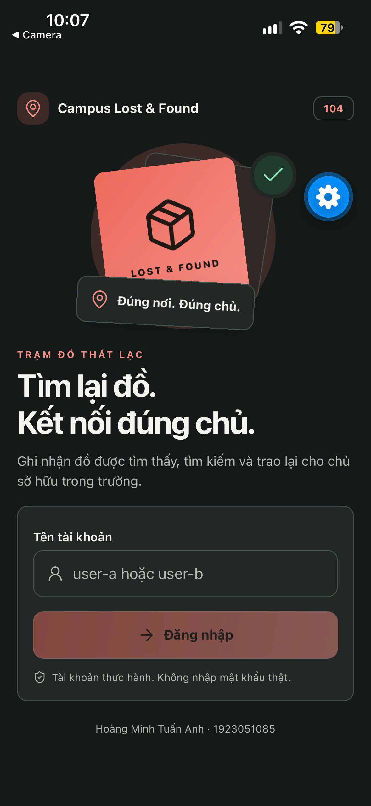<br><code>01-login.jpg</code> — Màn hình đăng nhập.</td>
<td>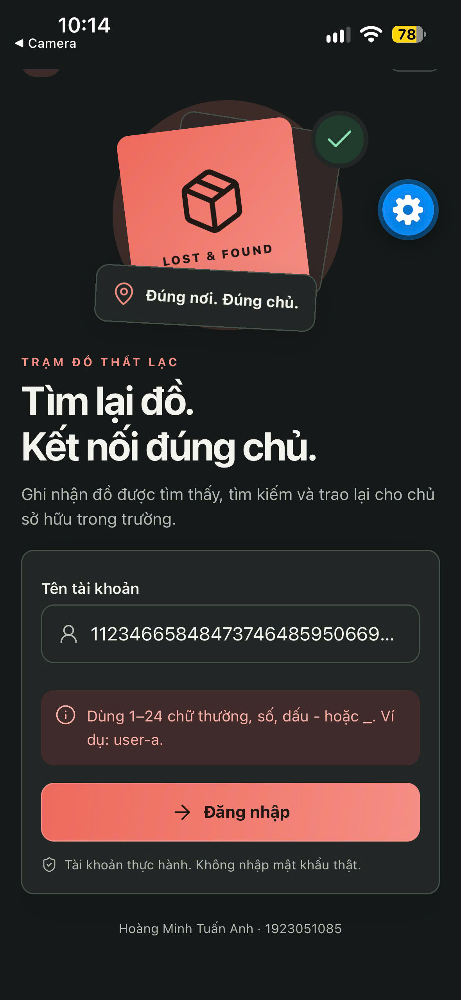<br><code>02-login-invalid-username.jpg</code> — Validation tên tài khoản không hợp lệ.</td>
</tr>
<tr>
<td>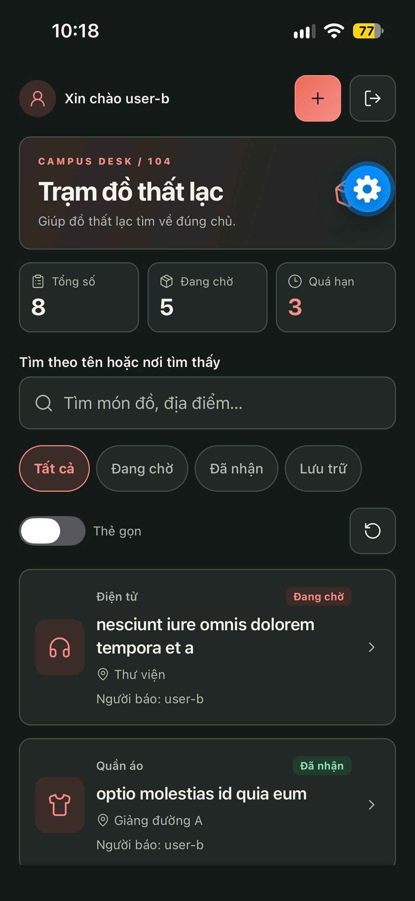<br><code>03-list-user-b-all.jpg</code> — Danh sách của user-b, bộ lọc Tất cả.</td>
<td>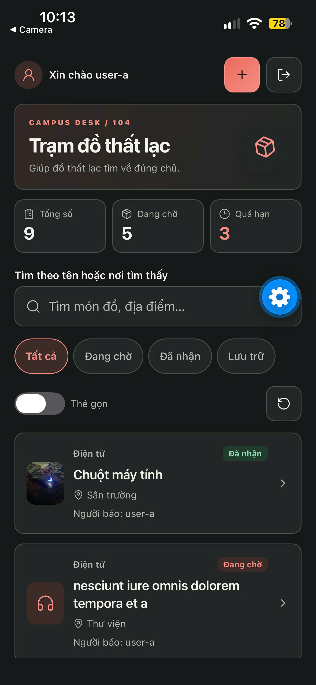<br><code>04-list-user-a-all.jpg</code> — Danh sách của user-a sau khi thêm Chuột máy tính.</td>
</tr>
<tr>
<td>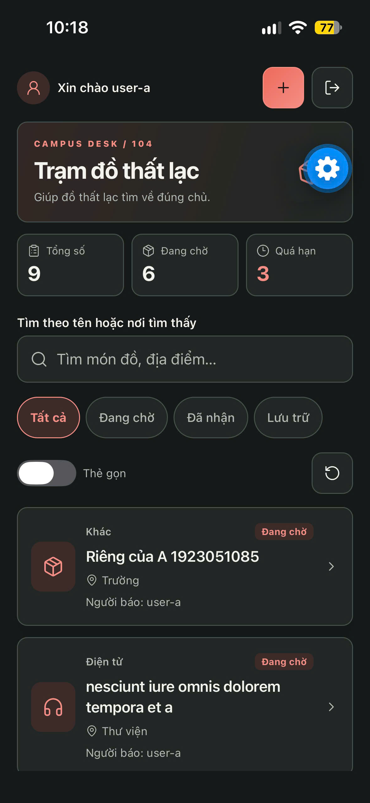<br><code>05-list-user-a-private-item.jpg</code> — Món riêng được tạo trong tài khoản A.</td>
<td>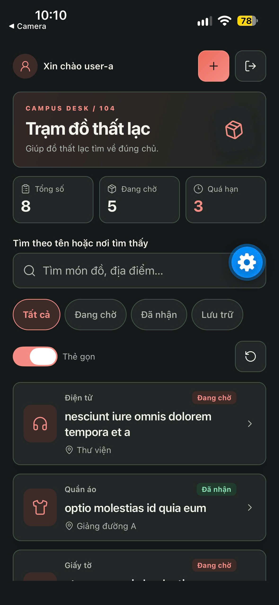<br><code>06-list-compact-cards.jpg</code> — Bật chế độ thẻ gọn.</td>
</tr>
<tr>
<td>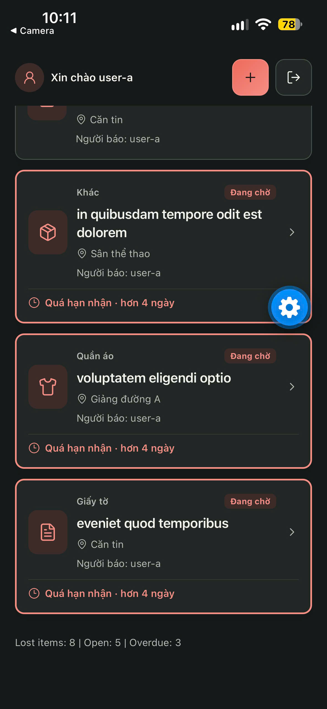<br><code>07-list-overdue-items.jpg</code> — Thẻ món quá hạn và tổng số cuối danh sách.</td>
<td>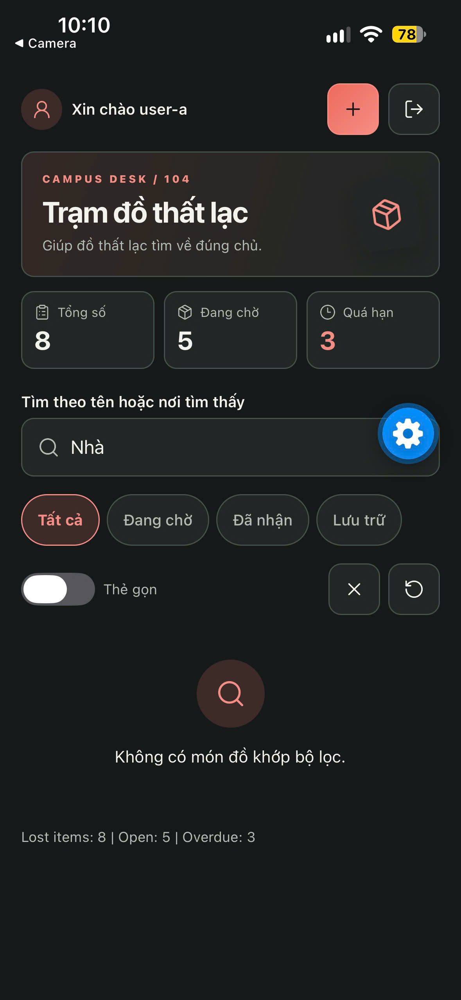<br><code>08-search-no-results.jpg</code> — Trạng thái không có món khớp truy vấn.</td>
</tr>
<tr>
<td>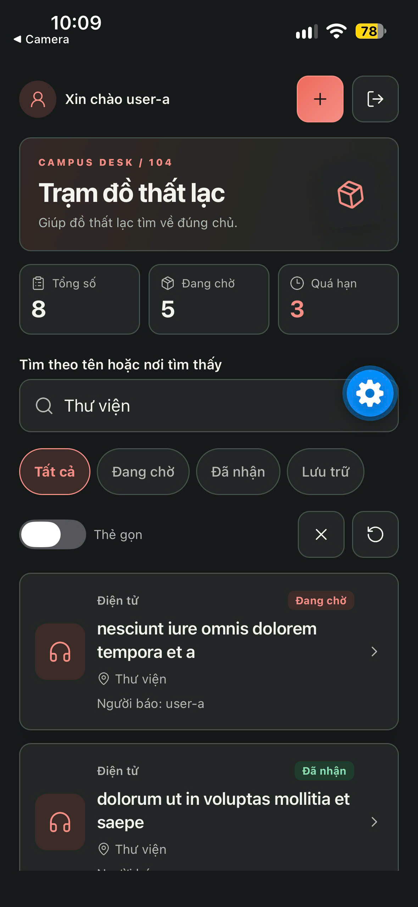<br><code>09-search-library-results.jpg</code> — Kết quả tìm theo địa điểm Thư viện.</td>
<td>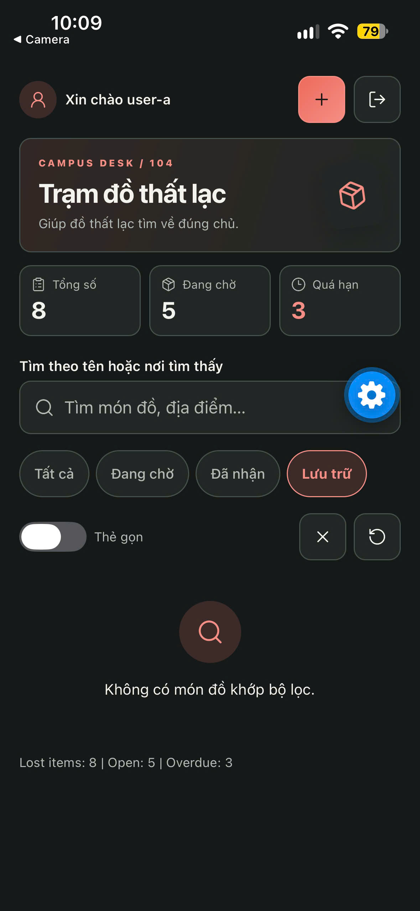<br><code>10-filter-archived-empty.jpg</code> — Bộ lọc Lưu trữ đang rỗng.</td>
</tr>
<tr>
<td>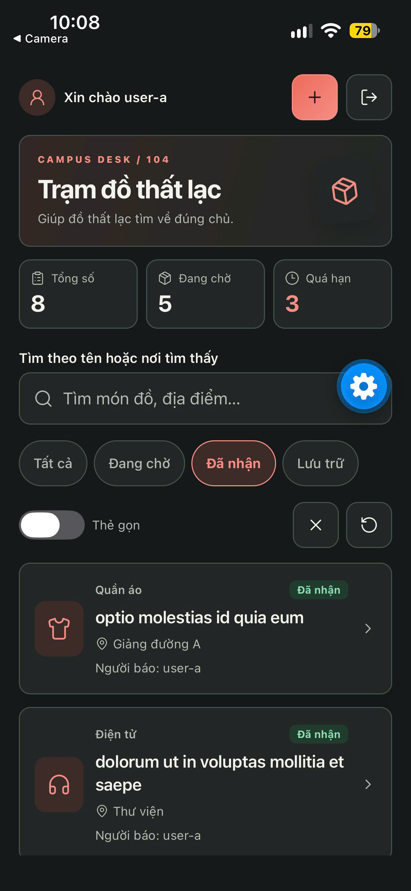<br><code>11-filter-claimed.jpg</code> — Bộ lọc Đã nhận.</td>
<td>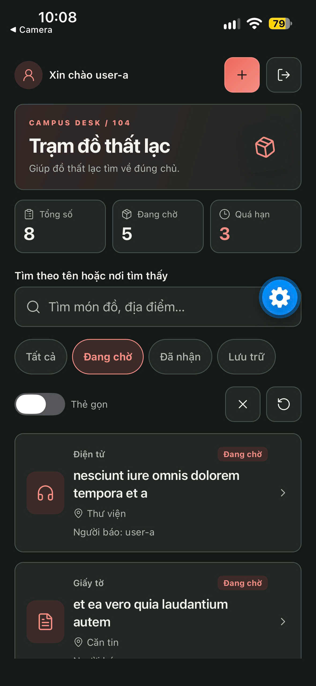<br><code>12-filter-open.jpg</code> — Bộ lọc Đang chờ.</td>
</tr>
<tr>
<td>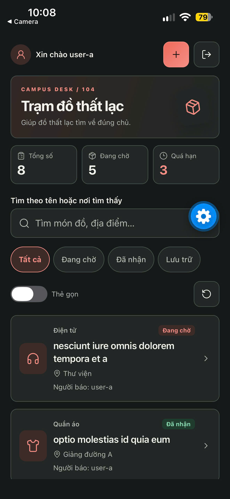<br><code>13-filter-all.jpg</code> — Bộ lọc Tất cả.</td>
<td>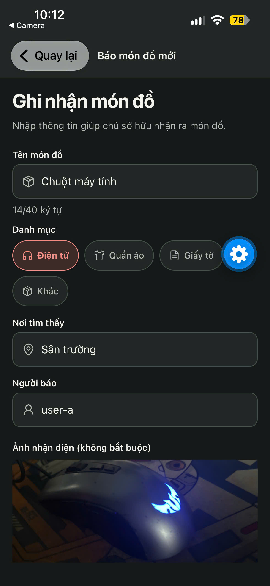<br><code>14-new-item-form-filled.jpg</code> — Form món Chuột máy tính, có ảnh preview.</td>
</tr>
<tr>
<td>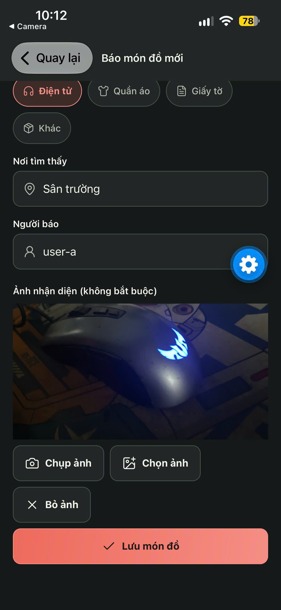<br><code>15-new-item-photo-controls.jpg</code> — Điều khiển chụp/chọn/bỏ ảnh và lưu món.</td>
<td>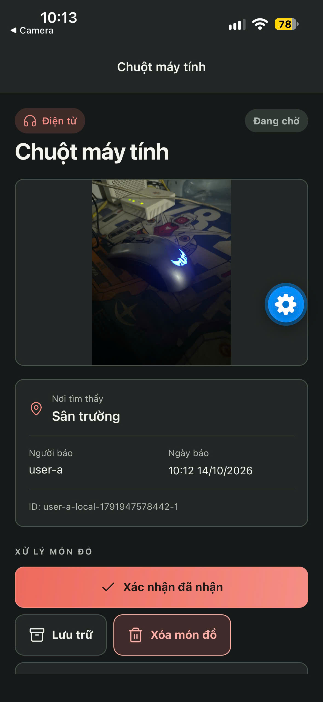<br><code>16-detail-open.jpg</code> — Chi tiết món đang chờ, có ảnh và thao tác nhận.</td>
</tr>
<tr>
<td>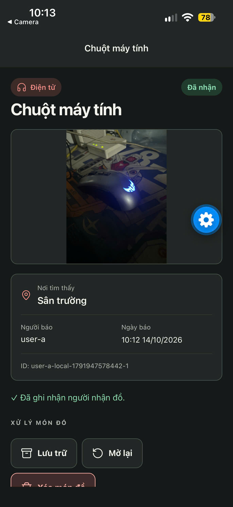<br><code>17-detail-claimed-photo.jpg</code> — Chi tiết Chuột máy tính ở trạng thái Đã nhận.</td>
<td>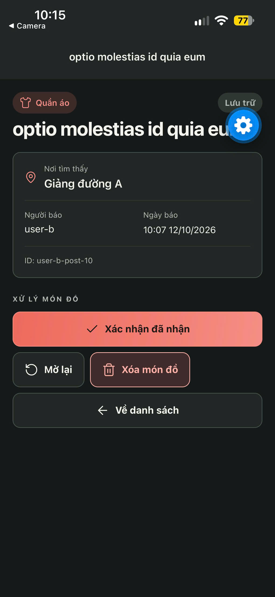<br><code>18-detail-archived.jpg</code> — Chi tiết món ở trạng thái Lưu trữ.</td>
</tr>
<tr>
<td>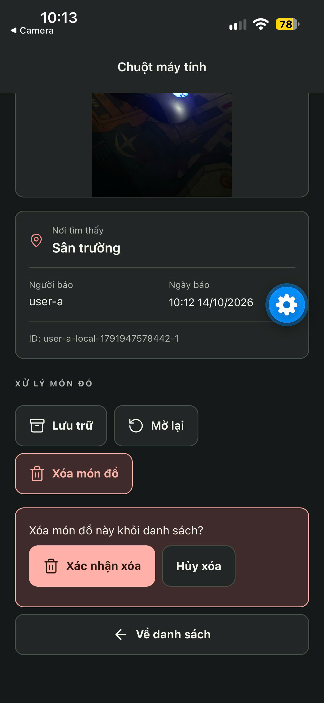<br><code>19-delete-confirmation.jpg</code> — Hộp xác nhận xóa món.</td>
<td></td>
</tr>
</table>
